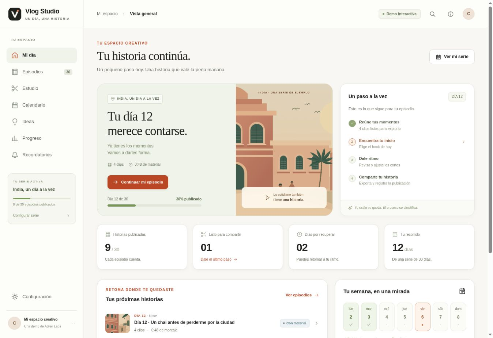

# Vlog Studio

Demo interactiva de Adren Labs para organizar una serie de vlogs, preparar su historia, montar fragmentos y llevar un registro de publicación. **Vlog Studio es un nombre provisional para esta demostración.**

La aplicación funciona como un sitio estático, sin compilación ni backend. Combina edición y almacenamiento locales con ejemplos de hooks y recomendaciones redactados como plantillas.

- Repositorio: [calebdani23/vlog-studio-mvp](https://github.com/calebdani23/vlog-studio-mvp).
- Demo pública: [Abrir Vlog Studio](https://calebdani23.github.io/vlog-studio-mvp/).
- Matriz funcional: [39 requisitos y cobertura de la demo](docs/FEATURES.md).



## Qué se puede probar

- Navegar entre el resumen del día, los episodios, el calendario, las ideas y la configuración.
- Editar datos, notas y estados de trabajo y conservarlos en el mismo navegador.
- Organizar el calendario y guardar preferencias de recordatorios de demostración.
- Importar videos propios, reproducirlos y conservar sus archivos en IndexedDB.
- Seleccionar fragmentos, cambiar sus puntos de inicio y fin y ordenar el montaje.
- Revisar hooks de ejemplo y adaptar su texto.
- Exportar un video real desde el navegador y descargar un plan de edición en JSON.
- Registrar manualmente una publicación y actualizar el progreso de la serie.

Los hooks y las recomendaciones **son plantillas de demostración**. No hay una llamada a un modelo de IA, transcripción automática ni análisis semántico de los videos importados.

## Ejecutar en local

Sirve la carpeta mediante HTTP. Abrir `index.html` directamente como `file://` no es el recorrido soportado para sus módulos JavaScript y archivos multimedia.

```bash
git clone https://github.com/calebdani23/vlog-studio-mvp.git
cd vlog-studio-mvp
```

### Con Python

```bash
python3 -m http.server 8000 --bind 127.0.0.1
```

Abre [http://127.0.0.1:8000/#today](http://127.0.0.1:8000/#today).

### Con Node.js

Puedes usar un servidor estático mediante `npx`:

```bash
npx --yes http-server . -p 8000 -a 127.0.0.1 -c-1
```

Abre la misma dirección. La primera ejecución de este comando puede descargar `http-server` desde npm. La aplicación no necesita instalar dependencias ni ejecutar un paso de compilación.

Para detener cualquiera de los servidores, usa `Ctrl+C` en su terminal.

## Recorrido de demostración

### 1. Comenzar en Hoy

Abre `#today`. El estado inicial contiene una serie ficticia llamada **India, un día a la vez**, con una meta de 30 días. La demostración está anclada al día 12, el 6 de noviembre de 2026.

El punto de partida es:

| Estado | Episodios |
| --- | ---: |
| Publicados de muestra | 9 |
| Listo | 1 |
| En edición | 1 |
| Con material | 1 |
| Planeados | 18 |

Estos registros ilustran el producto; no acreditan publicaciones reales.

### 2. Recorrer el estudio del día 12

Abre `#studio/ep-12/1` y avanza por los cuatro pasos del estudio:

1. `#studio/ep-12/1`
2. `#studio/ep-12/2`
3. `#studio/ep-12/3`
4. `#studio/ep-12/4`

Durante el recorrido, revisa el material, la historia y el hook; selecciona y ajusta los fragmentos; comprueba su orden y termina en la exportación o el registro de publicación. La historia de ejemplo es **Un chai antes de perderme por la ciudad**.

Los cuatro clips de muestra —mañana, mercado, chai y atardecer— duran 12 segundos cada uno. El material completo suma 48 segundos frente a una duración objetivo de 60 segundos. La duración objetivo no añade metraje por sí misma.

Prueba a excluir un clip: la duración seleccionada debe bajar. Vuelve a incluirlo, ajusta un corte y cambia el orden para comprobar que el montaje responde a tus decisiones.

### 3. Importar un video propio

Usa la opción de añadir clips y elige un archivo de video del dispositivo. El límite de la demo es **250 MB por clip**. La importación depende de que el navegador pueda decodificar el archivo.

El video se guarda localmente en IndexedDB. Se genera una miniatura y se lee su duración. Los videos importados no reciben una transcripción inventada: su campo de transcripción comienza vacío.

### 4. Exportar

La exportación reproduce los fragmentos seleccionados, los dibuja en un `canvas` y graba el resultado con `MediaRecorder`. Produce un archivo de video real, cuyo formato depende de lo que admita el navegador:

- WebM cuando está disponible el perfil elegido por la aplicación.
- MP4 cuando el navegador lo admite y corresponde a la selección de compatibilidad.

Mantén abierta la pestaña mientras se genera el archivo. El proceso se realiza durante la reproducción del montaje, no mediante una cola de render en un servidor.

El perfil vertical de esta demo es **540 × 960**, con una captura configurada a 24 fotogramas por segundo. Los otros perfiles del motor son 960 × 540 y 640 × 640. Esta implementación no promete una entrega de producción a 1080 × 1920 ni precisión de edición profesional.

El plan JSON es una salida distinta: contiene datos y decisiones del proyecto. **No incluye los archivos de video importados ni sustituye una copia de esos originales.**

### 5. Registrar la publicación y revisar el calendario

Registrar una publicación es una confirmación manual del usuario. Descargar, exportar o compartir un archivo no demuestra que se haya publicado en una red social.

Abre `#calendar` para revisar la serie, los estados y los pendientes. El día narrado, el número del episodio y la fecha de publicación representan datos diferentes. Publicar tarde no debería renumerar el día de la experiencia.

El estado de muestra cuenta 12 episodios previstos hasta el día actual, 9 publicados y 2 pendientes anteriores a ese día. El episodio del día 12 forma parte de lo previsto para hoy y todavía no se cuenta como atraso.

## Datos ficticios y medios de muestra

El estado inicial está marcado con `isDemo: true`, `synthetic: true` y `seed: 'demo'`.

- Las historias, notas, ideas y publicaciones son ejemplos ficticios.
- Las ilustraciones SVG y los videos MP4 de muestra se han creado para esta demo; no son grabaciones de un viaje real.
- Los MP4 de muestra no tienen audio.
- Los textos llamados guiones o transcripciones de muestra son ficticios. No proceden del audio de esos archivos y no ofrecen alineación con una conversación real.
- Un hook que requiere una nueva toma es una propuesta textual. No se convierte automáticamente en voz ni se añade como locución al video.

## Almacenamiento y alcance técnico

| Elemento | Dónde se conserva |
| --- | --- |
| Configuración, episodios, notas y decisiones | `localStorage` del sitio en el navegador |
| Archivos de video importados | IndexedDB del sitio en el navegador |
| Video exportado | Descarga elegida por el usuario |
| Plan JSON | Descarga de datos y decisiones; sin los archivos originales |

Los clips locales no se envían a un servidor. El navegador sí descarga la aplicación y sus recursos de demostración desde el sitio donde esté alojada.

El almacenamiento pertenece al origen del sitio y al perfil del navegador. Cambiar de navegador, dispositivo, host o puerto no sincroniza el proyecto. Borrar los datos del sitio puede eliminar el estado y las copias locales de los clips; los archivos originales del dispositivo permanecen aparte.

Esta demo no incluye cuentas, colaboración multiusuario, sincronización en la nube, backend, IA en la nube, publicación por API ni notificaciones con la aplicación cerrada. Configurar un horario de recordatorio no crea una tarea externa ni garantiza una notificación en segundo plano.

## Publicar en GitHub Pages

Configuración prevista para este repositorio:

1. Mantener `index.html`, los módulos JavaScript, estilos y recursos en la rama `main`.
2. Abrir la configuración de Pages del repositorio.
3. Elegir publicación desde una rama, seleccionar **`main`** y la carpeta **`/ (root)`**.
4. Guardar y esperar el resultado del despliegue.
5. Abrir la URL que GitHub muestre y comprobar `#today`, las rutas del estudio y la carga de los videos.

Las rutas con `#` conservan la navegación dentro del documento estático y los recursos usan rutas relativas. La aplicación no requiere variables de entorno ni secretos para esta modalidad.

Despliegue inicial verificado el 6 de noviembre de 2026: [ejecución de GitHub Pages completada](https://github.com/calebdani23/vlog-studio-mvp/actions/runs/42208673885). Se abrió la URL pública y se recorrió el estudio. Las futuras actualizaciones de `main` se publican mediante esta misma configuración.

## Estructura

```text
index.html       Entrada del sitio
app.js           Interfaz, rutas y acciones del usuario
data.js          Estado ficticio inicial y métricas
media.js         IndexedDB, importación y exportación audiovisual
styles.css       Estilos de la interfaz
polish.css       Ajustes visuales
assets/          Ilustraciones y videos de demostración
docs/FEATURES.md Cobertura funcional y recorrido de revisión
```

## Comprobaciones

```bash
npm run check
npm test
```

Estas comprobaciones de código no sustituyen la revisión en navegador de importación, reproducción, persistencia y exportación. La [matriz funcional](docs/FEATURES.md) incluye un recorrido manual para evaluar esas operaciones.

## Validación de esta entrega

- Cuatro pruebas de dominio aprobadas con `npm test`: publicación tardía, contadores y progreso, metas y cierre, y archivos de muestra.
- Comprobación de sintaxis de los módulos JavaScript.
- Recorrido en navegador de selección de clips, edición y persistencia del hook, recorte, orden, deshacer, registro manual y calendario.
- Exportación de video desde el sitio publicado: archivo WebM real con video VP9 a 540 × 960 y pista Opus. El material de ejemplo es silencioso.
- La importación de archivos, los formatos móviles y otros navegadores requieren una revisión adicional en dispositivos reales antes de usar el producto en producción.

La frecuencia efectiva de fotogramas y la estabilidad de la exportación dependen del navegador y de mantener la pestaña activa. Esta entrega es un MVP demostrable, no una app de producción.
